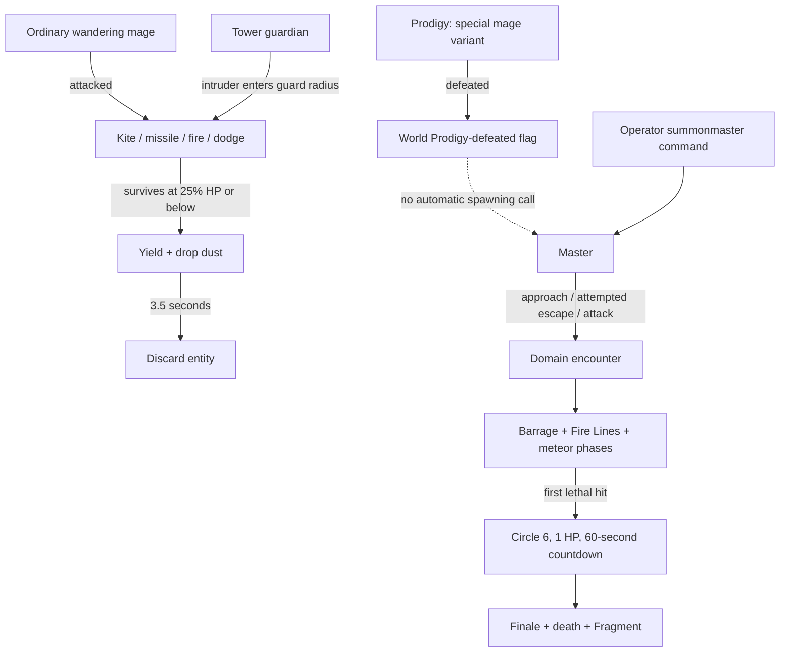

# CircleMage 2.3.0 — NPC and boss review

This is an implementation review, not a patch. No old files were edited. Findings marked **confirmed from source** describe branches/state that can be read directly; their in-game consequences are reasoned predictions unless explicitly identified as saved-world observations. No new runtime reproduction or performance benchmark was run.

## What is already implemented

The NPC work is well beyond a placeholder:

- **Wandering mages:** randomized names and circle-1–3 stats, neutral encounters, greetings, progress hints, emerald-to-vial trading, ambient channeling, retaliatory targeting, ranged kiting, locked-aim missile telegraphs, projectile dodging, emergency Thunder, surrender, drops, and journal discovery.
- **Tower guardians:** the same mage entity with a saved guard post, persistent identity, proximity aggression, and one-time tower loot/guard initialization.
- **Prodigy:** a special persistent circle-3 mage, 60 HP, stronger/faster combat, unique natural-spawn progression flags, no surrender, and crystal reward. It shares the ordinary mage AI rather than having a distinct phase controller.
- **Master:** a separate 100-HP boss with neutral engagement rules, boss bar, domain barrier, center-based movement, barrage, threshold Fire Lines, levitating meteor phases, Barrier retaliation, circle-6 ascension, 60-second desperation phase, reduced Hollow Purple finale, and Fragment reward.
- **Supporting systems:** persistent world progression, persistent boss-zone definitions, meteor telegraphs, casting-circle rendering, camera shake, impact frames, grayscale, and journal synchronization.

The main weaknesses are role boundaries and lifecycle consistency. Ordinary mage behavior is reused for guards without enough guard-specific rules, and combat/world state is split between persistent flags and transient fields.

## Current state flow

This diagram shows why guards disappear and why the Master does not naturally follow the Prodigy in the current project.

## Priority findings

| Priority | Finding | Evidence level | Main consequence |
|---|---|---|---|
| High | Guard wandering, pursuit, surrender, and one-time spawn do not form a durable guard role | Confirmed from source | Towers can lose their guardian permanently; guards roam/pursue away from their post |
| High | Master punishment runs before a Barrier cast is validated | Confirmed from source | Failed or non-dome casts can consume the one-time retaliation and lock out Barrier |
| High | Time Stop cleanup is tied to transient player/entity IDs | Confirmed omission; runtime persistence risk | NPC/boss AI may remain disabled across player/world lifecycle events |
| High | Domains scan only nearby entities and silently admit deep entrants | Confirmed from source | Long teleports can bypass containment; saved membership is not stable |
| Medium | Pending Master attacks are only partially serialized | Confirmed from source | Reload can cancel retaliation/sweeps while their persistent flags remain consumed |
| Medium | Mage range bands and visibility rules disagree | Confirmed from source | The 50–75 block band still uses mid-range fire; some direct spells ignore cover |
| Medium | Projectile sidestep has no independent recovery limit | Confirmed from source | Repeated detections can add velocity each tick and suppress offensive decisions |
| Medium | Master encounter is command-only despite eligibility helper | Confirmed integration gap | Natural boss progression stops at Prodigy |
| Medium | Unique encounter flags are booleans without entity identity | Confirmed design limitation | Reload/admin/older-save reconciliation is fragile |
| Medium | Active zones can tick while their boss is unloaded | Confirmed from source; impact needs playtest | Domain/meteor state can outlive the ticking owner |
| Medium | Mage surrender is not serialized | Confirmed from source | Reload can reset surrender after its tribute was already dropped |
| Low/medium | High meteor/VFX volume and fixed-height Fire Lines | Source-derived risks | Performance/readability and uneven-terrain fairness need measurements |

### 1. Make tower guardians an explicit role

**Evidence:** `WanderingMageEntity.java` lines 187–193 always install `MageIdleChannelGoal` and `WanderAroundFarGoal`. `MageIdleChannelGoal.java` lines 27–35 do not exclude guards. Guard return logic at `WanderingMageEntity.java` lines 511–522 runs only when there is no target, and only returns a guard more than 20 blocks from the post. Target loss at lines 504–509 is based on 75 blocks from the **mage**, not the guard post. Surrender at lines 336–339 excludes Prodigies but does not exclude guards; lines 475–486 discard a retreating entity.

`MageTowers.java` lines 74–98 marks a tower initialized and later spawns its guard. `WorldProgressState.java` lines 72–79 retain that initialization. There is no guardian UUID, defeated/escaped state, or replacement policy.

**Recommendation:** keep the shared spell executor, but give guards a separate movement/target policy. Restrict ambient movement to patrol points near the post, leash combat to the tower, and clear targets after intruders leave a defined radius/grace period. Decide whether a guardian fights to the death, surrenders and remains, or returns after a delay. Do not inherit permanent escape accidentally. Track tower loot initialization separately from guardian presence and intentional defeat.

**Initialization reliability:** `MageTowers.java` lines 77 and 103–114 mark the tower before checking a successful entity spawn; `spawnEntity`'s result is ignored. Use separate loot/guardian completion fields and validate spawn position and success before recording guard completion. Avoid retrying chest population when only the guard needs repair.

**Playtest:** enter an intact tower, lure its guard beyond the grounds, leave and return, force surrender, then save/reload. Repeat with obstructed/invalid spawn terrain. Confirm loot is not duplicated and the chosen guardian policy is consistent.

### 2. Trigger Master punishment after a successful dome creation

**Evidence:** `CircleMageMod.java` lines 723–735 invokes `MasterEntity.tryBarrierPunish` as soon as the packet identifies Barrier. Spell knowledge is checked at 747–750, pending casts at 753–755, cooldown at 770 onward, and mana later. Wall-versus-dome is resolved from sneak at 758–765, after the hook. The restriction check happens before the hook, so the first attempt can proceed while later ones are blocked.

**Recommendation:** define the mechanic precisely: successful self dome, any successful Barrier, or attempted Barrier. The existing comments/dialogue describe a raised self Barrier. For that intent, notify the Master from the successful cast completion/spawn path, using the resolved dome flag. Make the retaliation idempotent and persist its scheduled target/time or explicitly cancel it with a documented policy on reload.

**Playtest:** attempt Barrier while unknown, out of mana, on cooldown, or already casting; cast a normal wall; then successfully cast a sneak dome. Only the intended successful action should change the boss restriction/retaliation state. Check two players using Barrier in the same tick.

### 3. Give Time Stop world-owned cleanup

**Evidence:** `CircleMageMod.java` lines 1330–1350 sets nearby mob AI disabled and records numeric entity IDs in the caster's `ManaData`. Restoration looks up those IDs in the caster's **current world** after the timer ends. The timer and frozen-mob set are transient; `ManaData`'s NBT/copy lifecycle does not preserve a restoration record. There is no matching disconnect, dimension-change, death, chunk-unload, or server-stop restoration path in this code.

**Risk:** leaving before cleanup can lose the only list that knows which NPCs were changed. Numeric IDs are unsuitable across dimensions/reloads. Permanent disabled-AI behavior depends on Minecraft's entity save/load lifecycle and should be reproduced before calling it observed. Concurrent casters also share affected mobs without an explicit ownership/ref-count policy.

**Recommendation:** track affected entities by dimension and UUID in a world-owned freeze service, store their previous AI state, and track expiry/active owners. Restore from all exit paths and reconcile on entity load. Avoid simply enabling AI on entities that were intentionally NoAI before the spell. Define whether projectiles/boss custom tick logic should actually pause: zeroing velocity and disabling vanilla AI does not pause every custom entity `tick()` method.

**Playtest:** freeze a mage and Master; disconnect, die, change dimensions, unload the chunk, and restart during the stop. Test overlapping stops from two players and a deliberately NoAI entity. Check custom Master attack/countdown ticks as well as vanilla movement goals.

### 4. Validate teleports against domains, and retain participant identity

**Evidence:** `BossZone.java` lines 221–263 scans a box of `radius + 6`. A known insider teleported farther away is absent from this query, so cannot be pushed back. Lines 231–233 classify any unknown entity deeper than `radius - 2` as an insider, including an outsider teleported straight into the interior. The insider UUID set is not serialized; loaded zones reconstruct it from positions.

`Combinations.java`'s Thunder Warp validates dimension and a 10,000-block mark range, then requests a teleport without consulting BossZone containment. Ordinary shell crossing and projectiles are handled, but a long jump can bypass the shell logic.

**Recommendation:** enforce containment at authoritative teleport/movement entry points, and check tracked participants independently of the local shell scan. Give each encounter a stable participant set and define late joins, spectators, projectiles, pets, death, respawn, and dimension travel. Persist the relevant participants or intentionally rebuild them from a documented encounter roster; do not silently grant membership solely because an entity is deep inside.

**Playtest:** mark a point well outside a domain, enter and warp out. Warp an outsider into the center, reload with someone near the shell, and test dimension travel and death/respawn. Verify player-owned and Master-owned zones separately.

### 5. Serialize Master attack state consistently

**Evidence:** `MasterEntity.java` lines 933–955 save triggered/circle/phase2/countdown, completed meteor count, `barrierPunished`, `fireLineThreshold`, and number of Fire Line casts. They do not save the delayed punishment fire time/target, active sweep progress/angles/hit set, active meteor mode/hover center, barrage progress, or finale timer.

The mismatch matters beyond merely restarting animation: a saved `barrierPunished=true` survives while its pending retaliation disappears. A Fire Line's threshold is consumed before the cast starts, so reloading during it can lose the attack with that threshold still spent. Meteor handling can recreate a phase from HP, but does not explicitly reconcile every entity field with the separately saved zone state.

**Recommendation:** use a small explicit boss state model with phase, attack, elapsed/remaining ticks, target UUID, and parameters. Choose one policy for loading an in-progress attack: resume it, or cancel/retelegraph it while preserving fair cooldown/reward accounting. Save attack commitments and one-time flags together. Rebuild boss bar/zone state from the boss model, rather than allowing independent truth sources.

**Playtest:** save/reload during the two-second retaliation, each sweep direction, each meteor phase, ascension, the final second of countdown, and the finale. Confirm the Fragment is dropped once, domains are removed, and consumed attacks do not silently vanish or double-fire.

### 6. Fix range bands and decide how spells respect cover

**Evidence:** `WanderingMageCombatGoal.java` lines 86–103 handles 20–50 blocks as long range, then uses `else if (dist >= 5)` for mid range. Since an existing target remains valid out to 75 blocks, distances above 50 fall into the mid-range branch. `tryBurn` is called without the `canSee` condition; close-range wind also has no visibility gate.

**Recommendation:** make the bands exhaustive and mutually exclusive: close `<5`, mid `5–20`, long `20–50`, pursuit/no offensive casting `50–75`, target loss beyond the leash. Set explicit spell ranges. Require line of sight for directly placed offensive fields, or give cover-bypassing spells a conspicuous targeted warning and clear range limit. Revalidate visibility/range when a committed missile fires if that is the intended dodge/cover rule.

**Playtest:** stand at 4, 10, 25, 49, 51, and 74 blocks; repeat behind solid cover and around corners. Confirm the branch and spell chosen match the intended range/cover design.

### 7. Bound evasive movement and use player-relative intent

**Evidence:** `WanderingMageEntity.java` lines 724–749 performs a per-tick projectile query within 10 blocks. If an incoming projectile passes the dot-product test, it dashes if ready; otherwise it immediately adds sideways velocity and returns true. The fallback has no independent cooldown or velocity cap. The combat goal prioritizes this return over attacks.

The goal's rush/retreat decision compares successive mage-to-target distances with a very small threshold. The mage's own strafing/approach changes that distance, so it can mistake its own movement for player intent.

**Recommendation:** add a short dodge recovery window, an intended destination that is checked for walls/ground, and bounded horizontal impulse. Estimate time to impact and lateral miss distance so passing arrows do not repeatedly provoke dodges. Sample target velocity relative to the mage's own movement, or smooth distance over a wider interval. Keep the deliberate locked-shot window: its stationary telegraph creates a useful combat opening.

**Playtest:** sustained arrow fire, missed arrows, walls, cliffs, water, two attackers, and a stationary target while the mage strafes. Measure repeated impulses and how often it gets an offensive turn.

### 8. Complete encounter progression and identity tracking

**Evidence:** `WorldProgressState.java` has `canMasterSpawn()`, but repository search finds no caller. `BossMagicCommands.java`'s `summonMaster` spawns directly without that gate. Master is registered and its fight is implemented; the missing piece is the natural encounter trigger.

Prodigy eligibility uses world-wide alive/defeated booleans. Administrative `spawnprodigy` can create additional instances without consulting natural uniqueness. Existing old saves include multiple Prodigies/Masters, but those observations can come from prior builds or administrative tests and do **not** demonstrate a current natural-spawn bug.

**Recommendation:** select a concrete Master trigger after Prodigy defeat: a tower visit, an item ritual, a delayed pursuit event, or an explicit quest. Make it discoverable in the journal. Track unique encounter UUID, dimension, last known position, stage, and defeated reward state; reconcile against entity load/death/remove events. Keep an explicit force-spawn admin option for testing, distinct from normal progression. A Lich implementation would be new feature work; its saved flag is only infrastructure today.

**Playtest:** two players triggering progression together, Prodigy chunk unload/reload, admin force-spawn followed by ordinary exploration, and old-save migration. Confirm a living but unloaded unique NPC is not mistaken for a missing one.

### 9. Tie active zones to their owner's lifecycle

**Evidence:** `BossZoneManager.java` lines 110–124 only rejects a zone whose world has no server before ticking it. It does not check whether the owner entity is loaded/ticking/alive. `MasterEntity.java` lines 877–885 removes a zone only for removal reasons that destroy the entity, rather than ordinary unload. Boss zones are intentionally persisted.

**Recommendation:** distinguish unloaded, dead, deliberately removed, and missing owner states. Suspend encounter effects while an owner is unloaded, or keep an explicit bounded encounter ticket while players participate. Resume/reconcile on load. Do not indiscriminately delete a valid persisted zone just because a UUID is absent from the currently loaded entity collection.

Master-created zones also skip the `wouldOverlap` check used by the player command. Multiple summoned Masters can have overlapping arenas; restriction queries aggregate while the retaliation lookup chooses a containing zone. Prevent overlap, or define deterministic owner/participant routing.

**Playtest:** unload a boss during meteor rain, travel away/back, restart, remove/kill it, and summon two nearby Masters. Confirm no stale effects and no punishment routed to the wrong owner.

### 10. Preserve surrender and choose an NPC economy policy

**Evidence:** mage NBT at `WanderingMageEntity.java` lines 802–827 stores circle, Prodigy, used Thunder, and guard fields, but not retreat/escape time or whether surrender tribute was paid. Reloading a yielding mage can therefore reset that state after the dust was dropped. Repeated tribute farming is a plausible consequence requiring reproduction.

Friendly trading exchanges emeralds for vials without stock or cooldown. Greetings are remembered in a transient player-UUID set, while hint dialogue has a shared cooldown. NPCs have infinite spell mana; their channeling is visual only.

**Recommendation:** persist surrender state and remaining escape duration or a stable post-surrender state, plus a one-time tribute marker. If mages are meant to become lasting characters, replace discard with relocation/recovery and persist their identity. Set trade stock/pricing only if desired by the game design. Use per-player interaction cooldowns and private trade feedback to avoid nearby chat spam. Optional spell budgets/regeneration could create more readable openings, but are design work rather than a necessary correctness fix.

**Playtest:** reload within the 3.5-second surrender window, hit again after reload, and trade rapidly with two nearby players. Check tribute, hint availability, and chat output.

### 11. Measure meteor cost and ground the Fire Lines

**Evidence:** `MeteorRain.java` uses missile interval 10, warning 25 ticks, cap 160, plus fireball interval 70, warning 40, cap 48. The Master uses rate multipliers 100 and 60. The raw missile request is ten new warnings per tick until the cap limits it. Every active warning contributes particle work; impacts query entities and create effects. This is substantial potential volume, not proof that it currently causes lag.

Fire Line fronts at `MasterEntity.java` lines 702–715 remain at the boss's body height while moving horizontally, rather than following terrain.

**Recommendation:** profile server tick time and client frame time with one/two bosses and several players before tuning. Introduce encounter-wide warning/impact and VFX budgets, reduce distant warning particles, and share/simplify broad entity queries where possible. Keep damage/telegraph clarity independent of graphics settings. Either sample ground height along Fire Lines or deliberately present them as airborne beams so the visual and hit volumes agree on slopes and in towers.

**Playtest:** flat terrain, steep hills, tower interiors, bridges, low/high particle settings, multiplayer, Iris/Sodium, and a busy mob area. Record timings and missed/unreadable warnings; do not infer performance from entity counts alone.

## Adjacent problems that affect NPC combat or progression

- **Cross-dimension cleansing:** `AreaEffectManager.java` lines 36–46 removes any field containing the player's coordinates without checking its world. An Anti Magic cast could clear a field at corresponding coordinates in another dimension. Require world equality.
- **Session cleanup:** spell-field and array managers retain static lists and ServerWorld references. The server-stopped hook clears BossZoneManager and wand-light bookkeeping, but not those lists. Add explicit lifecycle cleanup so short-lived effects from a closed integrated-server world cannot tick in the next session.
- **School placeholders:** Water/Earth tomes can be spent without teaching anything, and Water wand bonuses have no spell assignment. Refuse empty tomes or label them dormant; this also avoids bad tower rewards.
- **Circle-9 pacing:** ten billion mana is approximately 289 continuous hours at the maximal ordinary circle-8 regeneration setup. Reduce the threshold, provide explicit late-game rewards, or change progression to a separate cumulative mastery track. No value was changed here.
- **Creation balance:** selected Creation exposes any registered item through `/lawcreate`, without operator gating. Decide whether inaccessible/admin items should be excluded in normal play.
- **Documentation/input drift:** old README/HANDOFF and domain feedback disagree with source values; saved key conflicts can obscure intended combat behavior. Update documentation/bindings only in a later authorized change.
- **Barrier cost feedback:** `MagicBarrierEntity.java` lines 46–47 and 177–180 use 500 mana/second upkeep plus 500 per absorbed hit. `CircleMageMod.java` lines 1883–1884 announces 100/second. Bring the feedback and intended mechanic into agreement; the guide follows the executable values.

## Suggested order for a future editing session

1. Guard role/leash/surrender, Barrier validation ordering, Time Stop restoration, and teleport containment.
2. NPC/boss serialization and owner-aware zone lifecycle, including old-save reconciliation.
3. Range/visibility fixes and bounded dodging; then Master progression and unique identity.
4. Profile and tune meteors/telegraphs, followed by differentiated Prodigy mechanics, richer NPC interaction, and the missing content chain.

Keep shared projectile/effect code, but separate **role policy** (wanderer, guard, Prodigy, Master) from spell execution and persistence. That gives room for new NPCs without reproducing the same guard/lifecycle problems in each one.

## Source links

- [WanderingMageEntity](../src/main/java/com/example/circlemage/entity/WanderingMageEntity.java), [WanderingMageCombatGoal](../src/main/java/com/example/circlemage/entity/WanderingMageCombatGoal.java), [MageIdleChannelGoal](../src/main/java/com/example/circlemage/entity/MageIdleChannelGoal.java)
- [MasterEntity](../src/main/java/com/example/circlemage/entity/MasterEntity.java), [MageTowers](../src/main/java/com/example/circlemage/world/MageTowers.java), [WorldProgressState](../src/main/java/com/example/circlemage/world/WorldProgressState.java)
- [CircleMageMod](../src/main/java/com/example/circlemage/CircleMageMod.java), [ManaData](../src/main/java/com/example/circlemage/mana/ManaData.java), [Combinations](../src/main/java/com/example/circlemage/spell/Combinations.java)
- [BossZone](../src/main/java/com/example/circlemage/boss/BossZone.java), [BossZoneManager](../src/main/java/com/example/circlemage/boss/BossZoneManager.java), [MeteorRain](../src/main/java/com/example/circlemage/boss/MeteorRain.java), [BossMagicCommands](../src/main/java/com/example/circlemage/command/BossMagicCommands.java)
- [AreaEffectManager](../src/main/java/com/example/circlemage/spell/AreaEffectManager.java), [MagicArrayManager](../src/main/java/com/example/circlemage/spell/MagicArrayManager.java)
